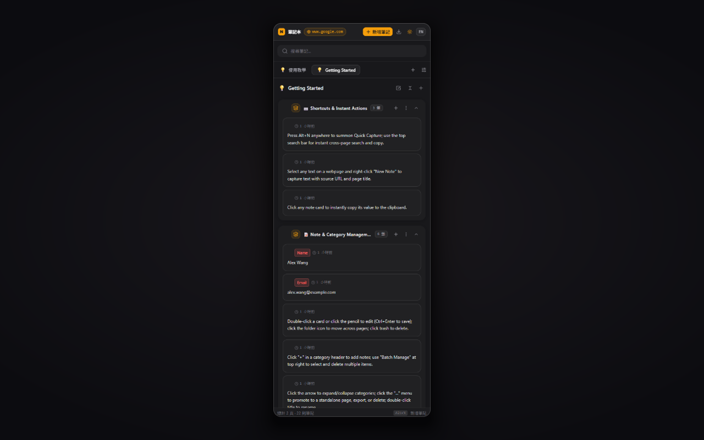
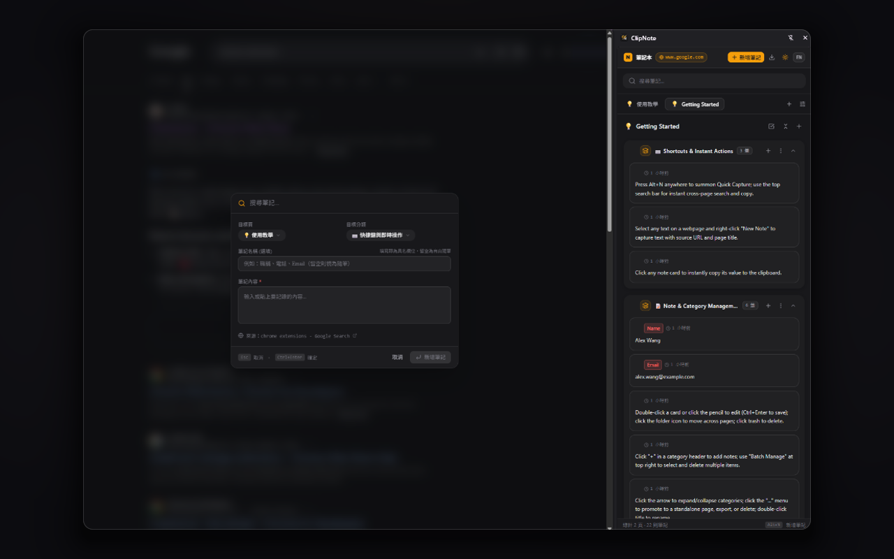
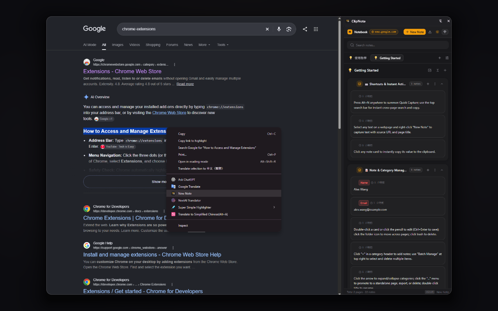
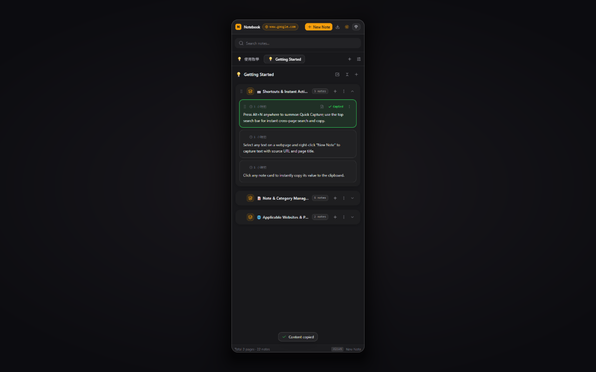
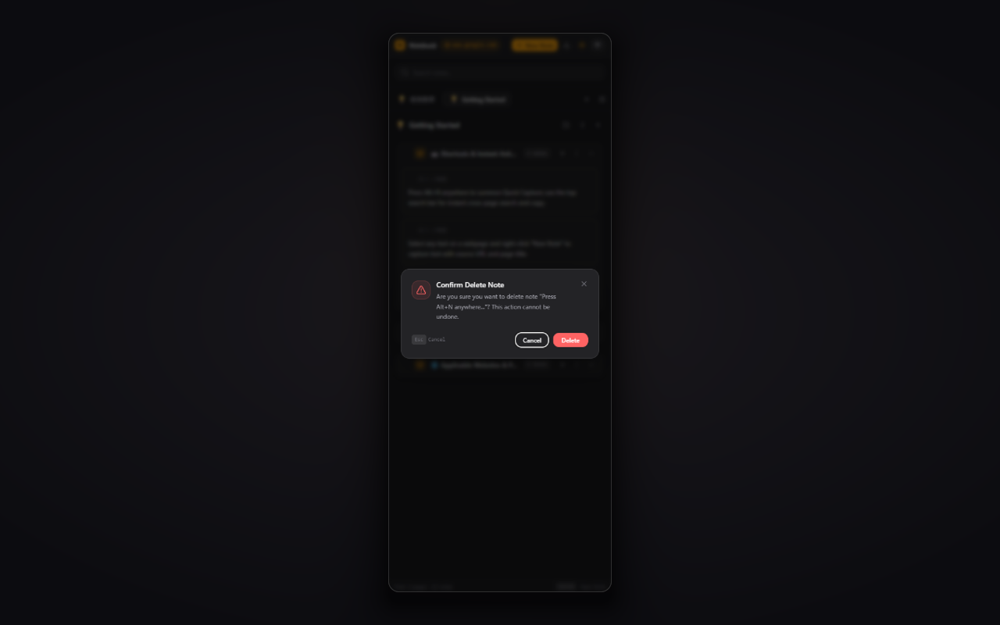

# ClipNote（筆記本）

輕量、感知網域的 Chrome 擴充功能：隨手記下網頁上的資訊，並在填寫表單時一鍵複製重複使用。

> Lightweight, domain-aware scratchpad and quick form-filling notepad for Chrome (Manifest V3).

**[👉 從 Chrome 線上應用程式商店安裝](https://chromewebstore.google.com/detail/clipnote/ghiglbnbnejcnppmajopgjghfofbhjpj)**

## 畫面截圖

| 側邊欄總覽 | 新增筆記（`Alt+N`） |
| :---: | :---: |
|  |  |
| **右鍵選單擷取** | **一鍵複製** |
|  |  |
| **刪除確認** | |
|  | |

## 功能特色

- **網域感知切換**：依目前分頁的網域自動開啟綁定的「頁」，未綁定時退回內建的 `🌐` 全域頁。
- **一鍵複製**：點擊筆記卡片即可複製完整內容（即使卡片已收合），不改動網頁 DOM，適用 React / Vue 等 SPA 表單。
- **新增筆記（`Alt+N`）**：在任何網頁叫出輕量浮動視窗，可記錄新筆記或即時搜尋既有筆記，`Enter` 複製並關閉。
- **右鍵選單擷取**：反白文字後右鍵「新增筆記」，自動帶入選取內容、來源網址與頁面標題。
- **側邊欄工作區（`Alt+S`）**：使用 Chrome 原生 Side Panel，不遮擋表單，適合連續填寫履歷等多欄位表單。
- **[欄位] 與 [隨筆] 混合**：筆記若有「筆記名稱」即為 [欄位]（Key-Value），否則為 [隨筆]；同一分類可自由混放。
- **整理工具**：分類拖曳排序、筆記跨分類拖放、移動筆記、升格為獨立一頁、批次管理、全部收合／展開。
- **JSON 匯出／匯入**：可匯出整本筆記本或指定頁面，於新裝置還原。
- **雙語介面**：繁體中文（`zh-TW`）與 English（`en`），支援深色／淺色主題。
- **完全本機儲存**：所有資料僅存於 `chrome.storage.local`，無外部伺服器、無追蹤，離線可用。

## 鍵盤快捷鍵

| 快捷鍵 | 功能 |
| :--- | :--- |
| `Alt+S` | 開啟／關閉 ClipNote 側邊欄 |
| `Alt+N` | 新增筆記／搜尋筆記 |
| `Ctrl+Enter` | 在對話框中快速儲存 |
| `Esc` | 關閉對話框或離開批次管理 |

快捷鍵可於 `chrome://extensions/shortcuts` 自訂。

## 開發

### 環境需求

- Node.js 20 以上
- Chrome（支援 Side Panel API 的版本）

### 安裝與啟動

```bash
npm install
npm run dev
```

`npm run dev` 會透過 [WXT](https://wxt.dev/) 啟動開發模式並自動開啟載入擴充功能的 Chrome。

### 手動載入建置版本

```bash
npm run build
```

1. 開啟 `chrome://extensions`，啟用「開發人員模式」。
2. 點選「載入未封裝項目」，選擇 `.output/chrome-mv3` 資料夾。

### 常用指令

| 指令 | 說明 |
| :--- | :--- |
| `npm run dev` | 開發模式（熱重載） |
| `npm run build` | 產生正式版建置至 `.output/chrome-mv3` |
| `npm run zip` | 打包上架用 zip |
| `npm run check` | TypeScript 型別檢查 + 單元測試（提交前必跑） |
| `npm run test` | 執行 Vitest 單元測試 |
| `npm run storybook` | 啟動 Storybook（port 6006） |

> Windows 環境請以 `cmd.exe /c "npm run check"` 形式執行，詳見 [AGENTS.md](AGENTS.md)。

## 專案結構

```
src/
├── entrypoints/      # background、content script、sidepanel 入口
├── components/       # React UI 元件（含 Storybook stories）
├── core/             # 領域模型、notebook-service、storage、theme
├── i18n/             # zh-TW / en 語系字串
├── styles/           # Tailwind 全域樣式
└── utils/            # 共用工具函式
public/_locales/      # Chrome manifest 多語系訊息
tests/                # Vitest 測試
docs/adr/             # 架構決策紀錄
```

技術堆疊：WXT · React 18 · TypeScript · Tailwind CSS · Vitest · Storybook

## 相關文件

- [SPEC.md](SPEC.md)：產品需求與規格
- [GLOSSARY.md](GLOSSARY.md)：雙語統一用語（頁／分類／筆記等）
- [CODING_STANDARDS.md](CODING_STANDARDS.md)：程式碼品質與審查準則
- [docs/adr/](docs/adr/)：架構決策紀錄
- [PRIVACY_POLICY.md](PRIVACY_POLICY.md)：隱私權政策
- [STORE_LISTING.md](STORE_LISTING.md)：Chrome 線上應用程式商店上架資料

## 權限說明

| 權限 | 用途 |
| :--- | :--- |
| `storage` | 將筆記儲存於本機 |
| `sidePanel` | 顯示側邊欄工作區 |
| `contextMenus` | 右鍵「新增筆記」 |
| `tabs` | 僅讀取作用中分頁的網址以進行網域感知切換 |
| `activeTab` | 擷取目前頁面的來源資訊 |
